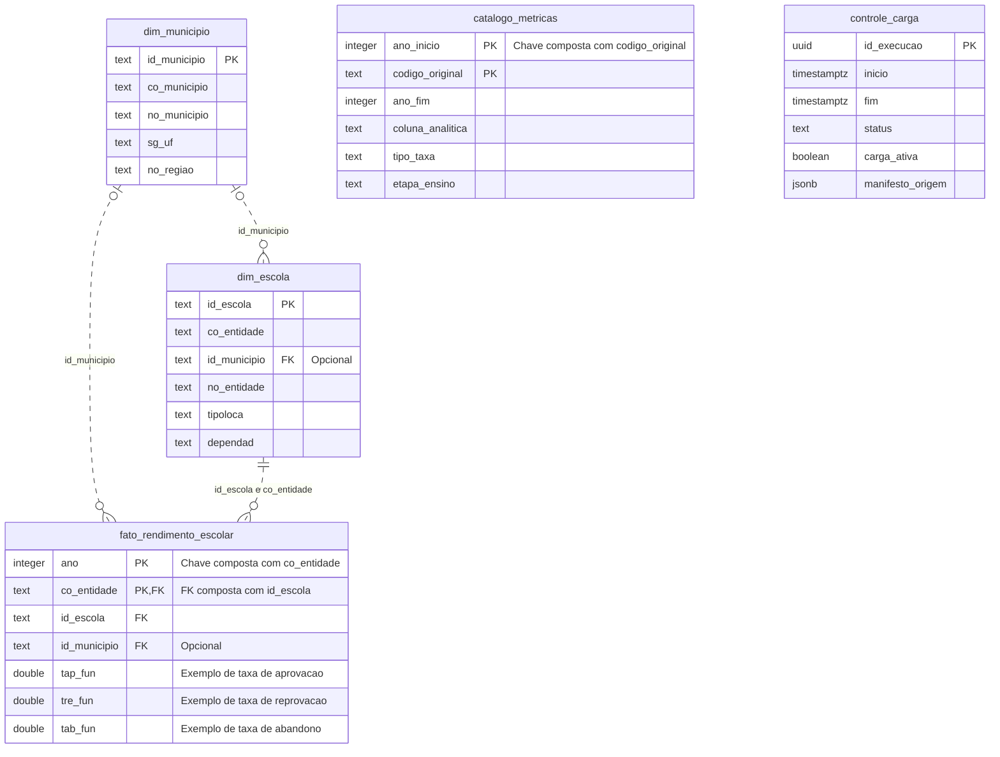
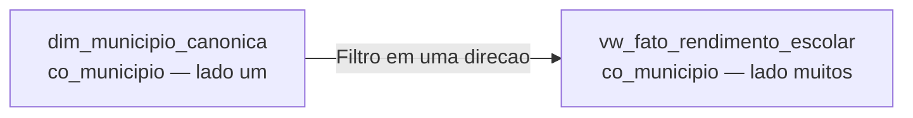

# Modelo do banco de dados

O PostgreSQL armazena a camada analítica das taxas de rendimento escolar. O histórico consolidado completo permanece em arquivos parquet. A estrutura física possui cinco tabelas e três relacionamentos por chave estrangeira, definidos em [schema.sql](../src/pipeline/banco/schema.sql).

## Diagrama das tabelas no PostgreSQL

O diagrama apresenta as chaves e os principais atributos. Os cinquenta e quatro campos de taxas e os demais atributos de auditoria foram omitidos para facilitar a leitura.

**Leitura do diagrama:** PK indica chave primária e FK indica chave estrangeira. Uma escola ou um município pode ser associado a diversas observações anuais. Cada observação referencia obrigatoriamente uma versão de escola; sua associação ao município é opcional. A associação entre escola e município também é opcional. As linhas tracejadas indicam relacionamentos não identificadores.

“catalogo_metricas” e “controle_carga” aparecem sem linhas porque não possuem chaves estrangeiras com as demais tabelas. Isso não impede que apoiem a interpretação dos indicadores e a auditoria das cargas.

## Conteúdo e chaves

| Tabela | Conteúdo e identificação |
| --- | --- |
| `fato_rendimento_escolar` | Uma observação por escola e ano, com cinquenta e quatro taxas de aprovação, reprovação e abandono. Chave primária composta por `ano` e `co_entidade`. |
| `dim_escola` | Versões dos atributos da escola, como nome, localização, dependência administrativa e município. Chave primária `id_escola`. |
| `dim_municipio` | Versões dos atributos municipais, com código, nome, UF e região. Chave primária `id_municipio`. |
| `catalogo_metricas` | Correspondência entre códigos originais e colunas analíticas, significado e período de validade. Chave primária composta por `ano_inicio` e `codigo_original`. |
| `controle_carga` | Situação, horários, contagens, validações e origem de cada execução de carga. Chave primária `id_execucao`. |

Os códigos `co_entidade` e `co_municipio` são armazenados como texto para preservar zeros à esquerda. Os identificadores técnicos `id_escola` e `id_municipio` são derivados dos atributos e distinguem suas versões históricas. Um mesmo código pode ter vários identificadores quando seus atributos mudam. Essas versões não possuem intervalos explícitos de início e fim de vigência.

### Relacionamentos definidos no SQL

| Origem | Destino | Regra |
| --- | --- | --- |
| `dim_escola.id_municipio` | `dim_municipio.id_municipio` | Permite valor nulo. |
| `fato_rendimento_escolar.(id_escola, co_entidade)` | `dim_escola.(id_escola, co_entidade)` | Chave estrangeira composta e obrigatória. A dimensão também possui uma restrição de unicidade para esse par. |
| `fato_rendimento_escolar.id_municipio` | `dim_municipio.id_municipio` | Permite valor nulo. |

As taxas aceitam valores nulos ou valores entre zero e cem. Nulo representa ausência de informação; zero é uma taxa válida. As referências não possuem exclusão ou atualização em cascata.

## Visões de apoio à consulta

As duas visões são definidas em [canonica.sql](../src/pipeline/banco/canonica.sql). Elas não são novas tabelas físicas nem acrescentam chaves estrangeiras ao esquema.

- **`dim_municipio_canonica`:** oferece uma representação por código municipal. Prioriza a versão observada no ano mais recente; em empate, a mais frequente nesse ano e, depois, a ordem do identificador técnico. Versões sem ano observado ficam após as datadas. Se nenhuma versão tiver ano, a escolha segue a ordem do identificador.
- **`vw_fato_rendimento_escolar`:** apresenta a tabela de rendimento acrescida de `co_municipio`, obtido por uma junção à dimensão histórica. A junção preserva as observações sem município e mantém a quantidade de linhas da tabela de fatos.

A representação canônica reúne diferentes grafias do mesmo código municipal nas consultas sem apagar os atributos históricos. Municípios homônimos continuam distintos pelo código.

## Correspondência com o Power BI

Esta comparação foi feita com o modelo contido no arquivo **Inep_Dashboard (7).pbix**, fornecido para revisão. Descreve a estrutura salva nessa versão; alterações posteriores no relatório precisam ser conferidas novamente.

### Fontes importadas do PostgreSQL

O arquivo possui cinco consultas ao PostgreSQL: `public dim_escola`, `public dim_municipio`, `public fato_rendimento_escolar`, `public dim_municipio_canonica` e `public vw_fato_rendimento_escolar`. As tabelas de catálogo e controle de carga não estão importadas nesse modelo.

Os quatro relacionamentos ativos encontrados são de muitos para um, com filtro em uma única direção, da dimensão para a tabela de fatos ou sua visão:

| Dimensão — lado um | Fato ou visão — lado muitos |
| --- | --- |
| `public dim_escola[id_escola]` | `public fato_rendimento_escolar[id_escola]` |
| `public dim_municipio[id_municipio]` | `public fato_rendimento_escolar[id_municipio]` |
| `public dim_escola[id_escola]` | `public vw_fato_rendimento_escolar[id_escola]` |
| `public dim_municipio_canonica[co_municipio]` | `public vw_fato_rendimento_escolar[co_municipio]` |

O relacionamento pela escola usa somente `id_escola` no Power BI. Isso é compatível com a unicidade desse identificador no PostgreSQL; o banco mantém também a verificação adicional da chave estrangeira composta com `co_entidade`. O Power BI não reproduz todos os relacionamentos físicos do banco nem suas restrições de integridade.

Para a consulta por município, o caminho canônico é:

### Tabelas calculadas no Power BI

| Tabela | Função confirmada pela expressão DAX |
| --- | --- |
| `DimAno` | Lista os anos distintos da tabela de rendimento importada. |
| `DimEtapa` | Oferece as opções “Ensino Fundamental” e “Ensino Médio”, consultadas pelas medidas. |
| `SelecaoSerie` | Oferece anos e séries para seleção nas medidas do histórico. |
| `DimEscolaCanonica` | Seleciona uma versão da escola no ano mais recente disponível e cria um rótulo com nome, município, UF e código INEP. Em empate de ano, ordena pelo identificador da versão. |

Essas quatro tabelas não possuem relacionamentos no arquivo examinado. Tabelas de seleção podem funcionar desconectadas quando suas escolhas são lidas explicitamente pelas medidas, como ocorre com etapa e série. A mera existência de `DimAno` ou `DimEscolaCanonica` não comprova que elas filtrem os fatos. Não foi encontrada aplicação de `DimAno` nas medidas examinadas.

O arquivo disponibilizado contém o modelo, mas não a definição das páginas e dos visuais. Por isso, não foi possível confirmar quais campos estão vinculados a cada filtro ou gráfico. **Não apresentar as tabelas auxiliares como dimensões relacionadas sem conferir essa utilização no relatório.**

### Contagem de escolas

As medidas de contagem examinadas usam `DISTINCTCOUNT` de `co_entidade`. Portanto, contam códigos de escolas distintos no contexto aplicado, e não versões de `id_escola` nem observações escola-ano.

Use os campos municipais da dimensão canônica nos filtros que devem atingir a visão da fato. Evite criar caminhos ativos alternativos que produzam ambiguidade. A associação de cada visual à medida correspondente deve ser conferida no relatório.

## Atualização dos dados

A etapa de persistência valida os arquivos em uma área temporária e publica os dados no PostgreSQL dentro de uma transação. A publicação é confirmada como conjunto ou desfeita se ocorrer erro antes da confirmação. Repetir a carga não acumula observações duplicadas, e cada execução recebe um registro de auditoria. Reduções de período ou contagens são bloqueadas para revisão.

Em um banco novo, `schema.sql` cria as tabelas; a rotina de persistência instala as visões de `canonica.sql`. Consulte os comandos no [README](../README.md#5-executar-a-persistência--etapa-6).

Atualizar o Power BI recarrega as fontes existentes: não importa novas visões nem troca automaticamente os campos dos gráficos. Os tipos e significados dos campos estão no [dicionário de dados](dicionario_dados.md). As taxas são percentuais; essa base não contém quantidades de alunos.
